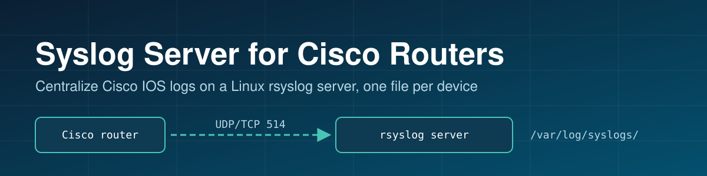

# Syslog Server for Cisco Routers

Step-by-step notes for sending Cisco IOS router logs to a central Linux **rsyslog** server, with one log file per device.

```
┌──────────────┐   UDP/TCP 514   ┌──────────────────────────┐
│ Cisco router │ ──────────────► │ Linux rsyslog server     │
│ (logging     │                 │ /var/log/syslogs/        │
│ host x.x.x.x)│                 │   <router-ip>.log        │
└──────────────┘                 └──────────────────────────┘
```

## Files

| File | What it covers |
|------|----------------|
| [`Cisco-RW-Config-SYS-LOG.txt`](Cisco-RW-Config-SYS-LOG.txt) | Router side: logging host, trap level, buffer, timestamps, config-change archive logging |
| [`Linux-SYS-LOG-Config.txt`](Linux-SYS-LOG-Config.txt) | Server side: install rsyslog, enable UDP/TCP 514, per-host log template, firewalld rules, validation |
| [`My References.txt`](My%20References.txt) | Sources used |

## Quick start

### 1. Linux server (CentOS / RHEL)

```bash
yum -y install rsyslog
```

In `/etc/rsyslog.conf`, enable reception:

```
$ModLoad imudp
$UDPServerRun 514
$ModLoad imtcp
$InputTCPServerRun 514
```

Write each remote device to its own file (at the start of the RULES section, before any other rule):

```
$template Remote,"/var/log/syslogs/%fromhost-ip%.log"
if $fromhost-ip != '127.0.0.1' then ?Remote
& stop
```

The `if` keeps the server's own logs in `/var/log/messages`; `& stop` replaces the deprecated `& ~`. Check the syntax with `rsyslogd -N1`.

Open the port and restart:

```bash
firewall-cmd --permanent --add-port=514/udp
firewall-cmd --permanent --add-port=514/tcp
firewall-cmd --reload
systemctl restart rsyslog
systemctl enable rsyslog
ss -tulnp | grep 514
```

### 2. Cisco router

```
conf t
 service timestamps log datetime msec localtime show-timezone
 logging buffered 100000 informational
 logging trap informational
 logging source-interface <interface>
 logging host <syslog-server-ip> session-id hostname
 logging on
 archive
  log config
   logging enable
   logging size 1000
   notify syslog contenttype plaintext
   hidekeys
end
write memory
```

The `archive / log config` block sends every configuration change to syslog, so you get an audit trail of who changed what.

For TCP instead of the default UDP, use `logging host <syslog-server-ip> transport tcp port 514 session-id hostname`.

### 3. Verify

On the router:

```
send log "syslog test from router"
```

On the server:

```bash
tail -f /var/log/syslogs/<router-ip>.log
```

Nothing arriving? Run `tcpdump -ni any port 514` on the server to see whether packets reach it.

## Notes

- If a hardware firewall sits between the router and server, ask for UDP/TCP 514 to be opened.
- `logging trap informational` sends severity 0–6; use `debugging` only for short troubleshooting windows.
